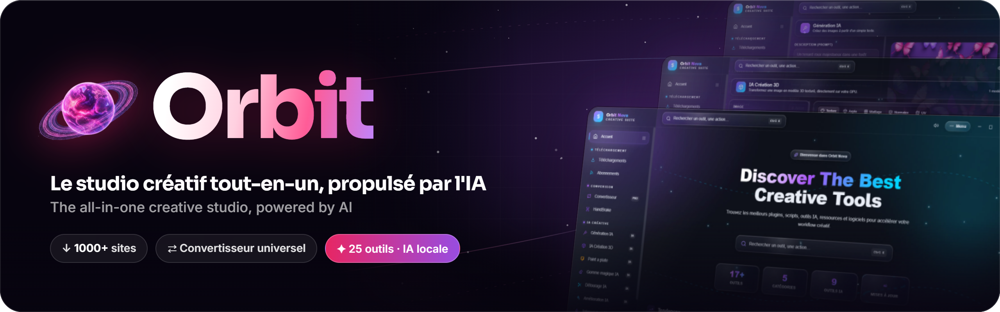
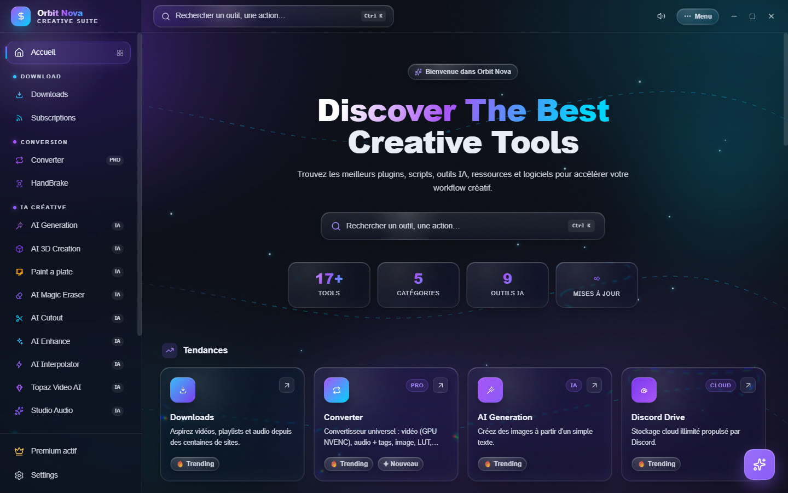
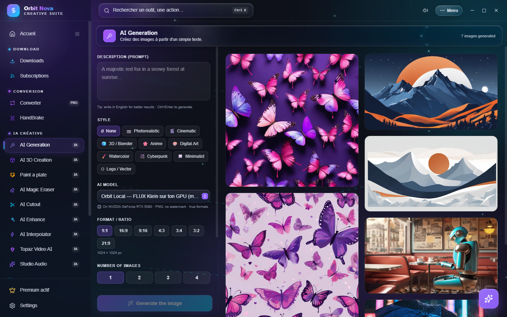
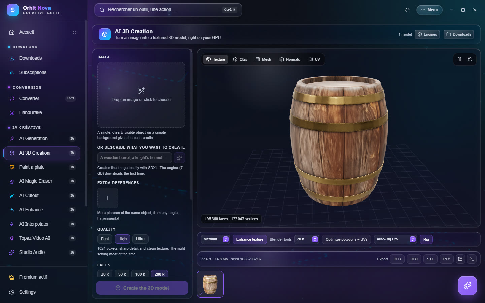
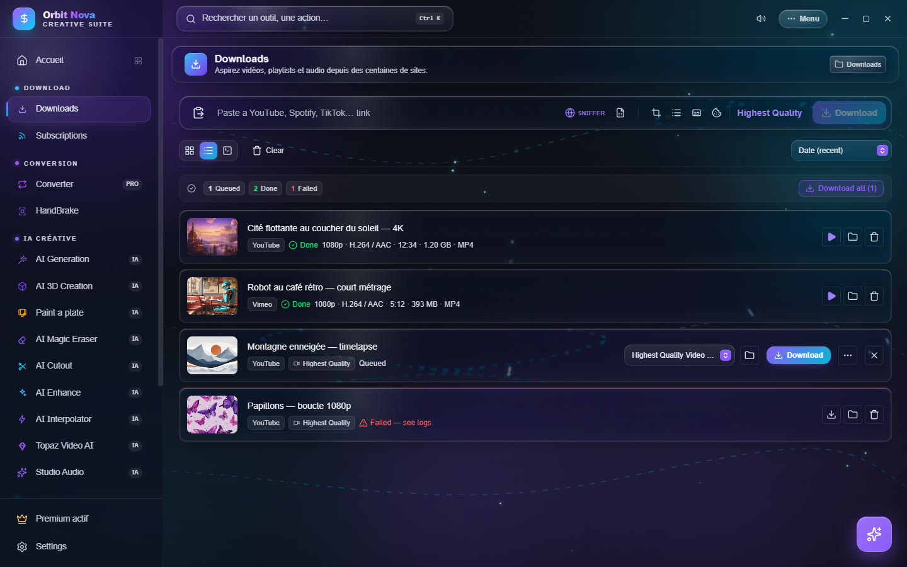
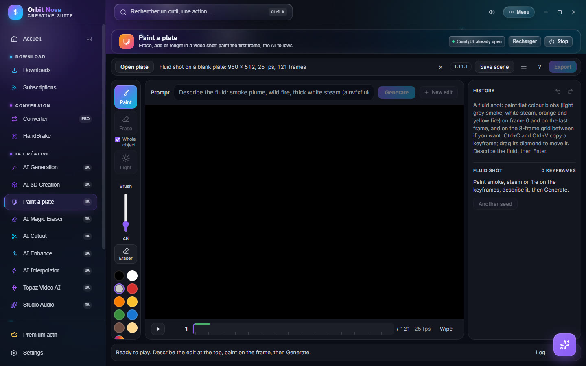
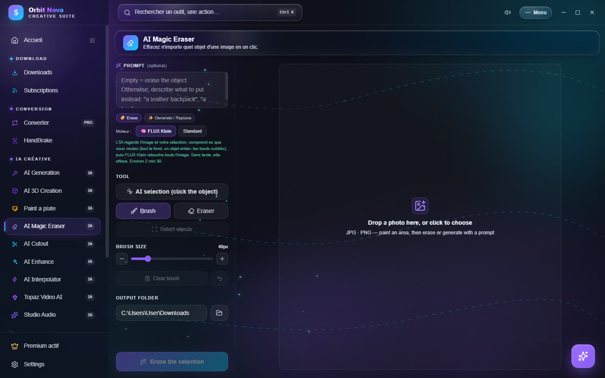
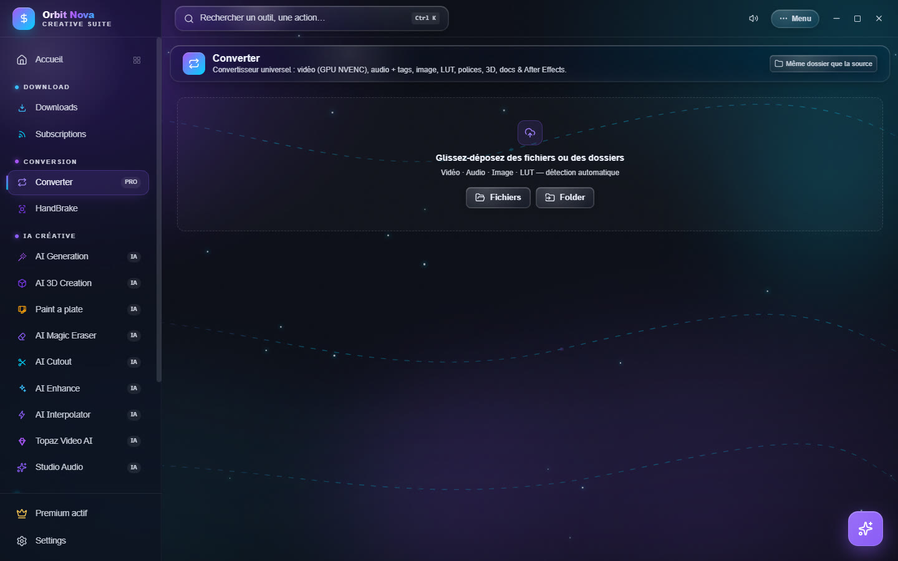

  

  <a href="README.md">🇫🇷 Français</a> · <b>🇬🇧 English</b>

  
  
  
  

  
  
  

 

**Orbit** brings together in one Windows app what usually takes a dozen programs: a **downloader** for more than
1000 sites, a **universal converter**, and **25 AI creative tools** (image, video, 3D, voice, music) that run
**on your own graphics card**.

No subscription, no credits, no watermark: your files stay on your PC.

  

## ✨ What Orbit does

| | |
|:--|:--|
| ⬇️ **Download** | Videos, playlists and music from YouTube, TikTok, Instagram, X, Twitch and 1000+ sites, up to 8K. **Spotify**, **Apple Music** and **Deezer** links with titles, covers and lyrics. File hosts (1fichier, MediaFire…), built-in stream sniffer browser, channel subscriptions, resume after a crash. |
| 🔄 **Convert** | Video (NVIDIA-accelerated), audio, image, LUT, fonts, 3D models, documents, **After Effects** presets (version compatibility). Built-in **HandBrake** and a **toolbox** of more than 60 quick tools. |
| 🎨 **Image AI** | Local **AI Generation** (SDXL, FLUX.2 klein), **Magic Eraser** (erase or replace an object), video **Cutout** without a green screen, **Enhance** (upscale up to 8K, restoration). |
| 🎬 **Video & 3D AI** | **Interpolator** up to 240 fps, **Paint a plate** (shot retouching), **AI 3D Creation** (image → rigged GLB/FBX model), **PBR Materials** (photo → full material), **AI Mocap** (video → 3D animation applied to your character). |
| 🎙️ **Voice & sound AI** | **AI Voice** (voice-over, voice design and cloning), **AI Dubbing** (a video in another language, with each person's real voice), **AI Foley**, **AI Music** (full songs, with lyrics), live **Voice Changer** for Discord/OBS, **Audio Studio** (stems, denoise), **Transcription**. |
| ☁️ **Orbit Drive** | End-to-end encrypted storage, Google-Drive-style **folder sync**, **shared folders** for teams, protected links (password, expiry, view only), opens in the browser on [orbit-drive.com](https://orbit-drive.com). |

Animated "Liquid Glass" interface, `Ctrl + K` search, AI assistant, **6 languages** (EN, FR, ES, DE, IT, PT) and
automatic updates.

## 🖼️ Preview

<table>
  <tr>
    <td width="50%">
<b>AI Generation</b> — local images, live preview
</td>
    <td width="50%">
<b>AI 3D Creation</b> — an image becomes a 3D model
</td>
  </tr>
  <tr>
    <td>
<b>Downloads</b> — 1000+ sites, playlists, music
</td>
    <td>
<b>Paint a plate</b> — AI retouching of video shots
</td>
  </tr>
  <tr>
    <td>
<b>Magic Eraser</b> — erase or replace an object
</td>
    <td>
<b>Converter</b> — video, audio, image, 3D, fonts, AE
</td>
  </tr>
</table>

## 💎 Free or Premium

Orbit is **free**. **Orbit Premium** unlocks the most advanced AI tools: **€14.99 once**, for life, on one
device.

| Free | Premium |
|:--|:--|
| Downloads, Spotify / Apple Music / Deezer, subscriptions | AI Generation, Magic Eraser, Cutout, Enhance |
| Converter, HandBrake, toolbox, media library | AI Interpolator, Topaz Video AI, Transcription |
| AI 3D Creation, Paint a plate | AI Voice, AI Dubbing, AI Foley, AI Music |
| Audio Studio (denoise, normalize, extract) | Voice Changer, PBR Materials, AI Mocap |
| Orbit Drive, AI assistant | Audio Studio: stem separation |

Details in the [Premium documentation](https://docs.orbit-drive.com/en/premium.html).

## 💻 Installation

1. Download **[Orbit-Installer.exe](https://github.com/ThomasDM40-dev/orbit-releases/releases/latest/download/Orbit-Installer.exe)**.
2. Run it and follow the setup (no administrator rights needed).
3. That's it: Orbit **updates itself**. Engines (yt-dlp, FFmpeg…) and AI models download the first time you use
   each tool.

> Windows may show "Windows protected your PC" on first launch: click **More info › Run anyway**.

| | Minimum | For the AI tools |
|:--|:--|:--|
| **System** | Windows 10 or 11, 64-bit | Windows 10 or 11, 64-bit |
| **Memory** | 8 GB | 16 GB or more |
| **Graphics card** | Any recent card | NVIDIA RTX, 8 GB VRAM or more (16 GB for 3D and Paint a plate) |
| **Disk** | 1 GB | From a few GB to more than 60 GB depending on the installed models |

The interface is in French by default and switches to English automatically on an English Windows (or in
*Settings › General › Language*).

## 🔒 Privacy

- The AI tools run **on your PC**: your images, videos and voice are sent nowhere.
- Once the models are downloaded, they work **offline**.
- Orbit Drive encrypts your files **before** upload (AES-256): neither the server nor Discord can read them.

## 📚 Links

- 📖 **[Full documentation](https://docs.orbit-drive.com/en/)** (English and French)
- 📝 **[Release notes](https://github.com/ThomasDM40-dev/orbit-releases/releases)** — also in the app: *Menu › Tools › changelog*
- 🐞 **Found a bug?** In Orbit: *Settings › About › Report a bug*

 

   
  © 2026 Orbit · ThomasDM40-dev · This repository hosts Orbit's public releases (installer and updates); the source code is not distributed.

