

  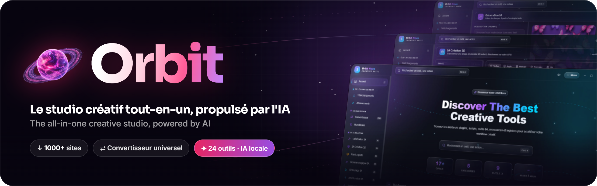

  <b>🇫🇷 Français</b> · <a href="README.en.md">🇬🇧 English</a>

  
  
  
  

  
  
  

 

**Orbit** réunit dans une seule application Windows ce qui demande d'habitude une dizaine de logiciels :
un **téléchargeur** pour plus de 1000 sites, un **convertisseur universel**, et **16 outils de création par IA**
(image, vidéo, 3D, voix, musique) qui tournent **sur votre propre carte graphique**.

Pas d'abonnement, pas de crédits, pas de filigrane : vos fichiers restent sur votre PC.

  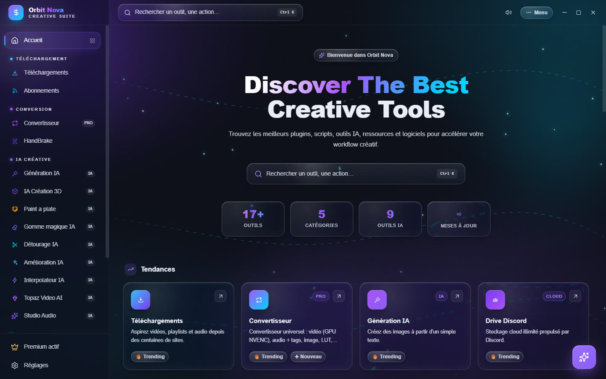

## ✨ Ce que fait Orbit

| | |
|:--|:--|
| ⬇️ **Télécharger** | Vidéos, playlists et musique depuis YouTube, TikTok, Instagram, X, Twitch et 1000+ sites, jusqu'en 8K. Liens **Spotify**, **Apple Music** et **Deezer** avec titres, pochettes et paroles. Hébergeurs (1fichier, MediaFire…), navigateur-renifleur intégré, abonnements aux chaînes, reprise après coupure. |
| 🔄 **Convertir** | Vidéo (accélérée NVIDIA), audio, image, LUT, polices, modèles 3D, documents, presets **After Effects** (compatibilité de version). **HandBrake** intégré et **boîte à outils** de plus de 60 petits outils. |
| 🎨 **IA image** | **Génération IA** locale (SDXL, FLUX.2 klein), **Gomme magique** (effacer ou remplacer un objet), **Détourage** vidéo sans fond vert, **Amélioration** (upscale jusqu'en 8K, restauration). |
| 🎬 **IA vidéo & 3D** | **Interpolateur** jusqu'à 240 i/s, **Paint a plate** (retouche de plans), **IA Création 3D** (image → modèle GLB/FBX riggé), **Matériaux PBR** (photo → matériau complet), **Mocap IA** (vidéo → animation 3D appliquée à votre personnage). |
| 🎙️ **IA voix & son** | **Voix IA** (voix off, création et clonage de voix), **Doublage IA** (une vidéo dans une autre langue, avec la vraie voix de chacun), **Bruitages IA**, **Musique IA** (chansons complètes, avec paroles), **Changeur de voix** en direct pour Discord/OBS, **Studio Audio** (stems, débruitage), **Transcription**. |
| ☁️ **Orbit Drive** | Stockage chiffré de bout en bout (Discord ou Telegram), connexion Google / Discord. **Synchronisation de dossiers** comme Google Drive, **dossiers partagés** à plusieurs (lecture seule ou modification). Liens protégés (mot de passe, expiration, lecture seule, QR code), **Drop** sans compte. Tags et couleurs, trier/filtrer, copier/dupliquer, propriétés, miniatures, visionneuse photo et 3D, pause/reprise des transferts. Tout est aussi sur [orbit-drive.com](https://orbit-drive.com). |

Interface « Liquid Glass » animée, recherche `Ctrl + K`, assistant IA, centre des tâches, **25 succès** à débloquer,
profil et réglages en 15 sections, **6 langues** (FR, EN, ES, DE, IT, PT) et mises à jour automatiques.

## 🖼️ Aperçu

<table>
  <tr>
    <td width="50%">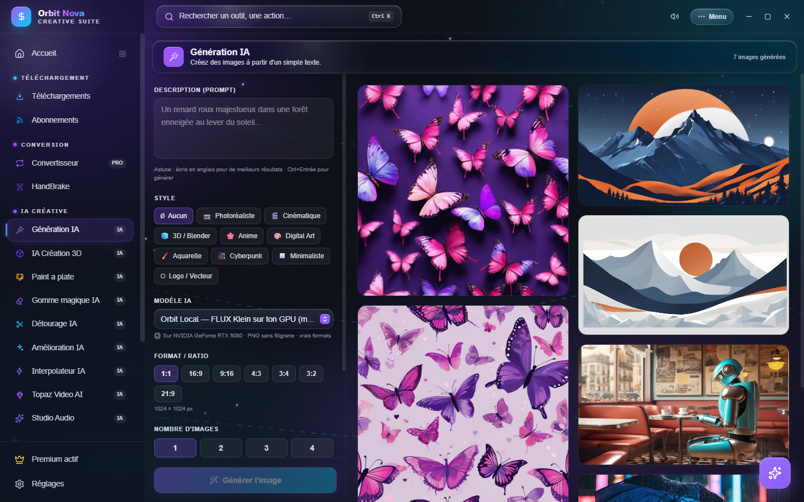
<b>Génération IA</b> — images en local, aperçu en direct
</td>
    <td width="50%">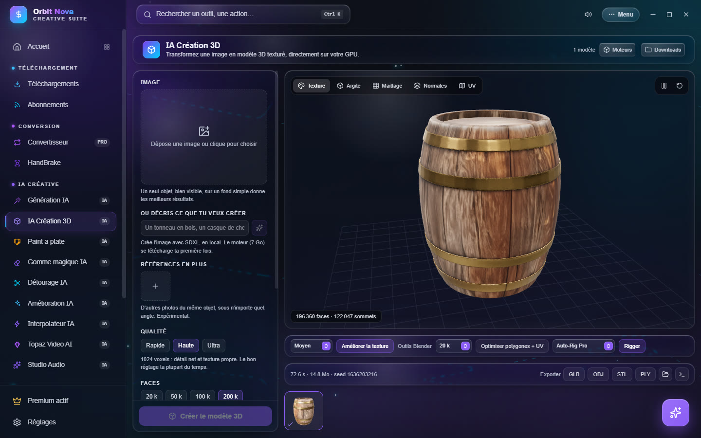
<b>IA Création 3D</b> — une image devient un modèle 3D
</td>
  </tr>
  <tr>
    <td>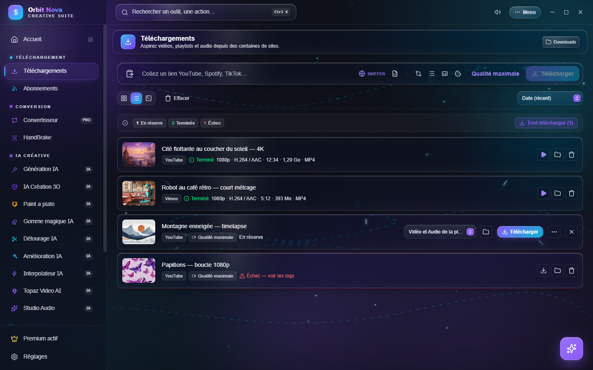
<b>Téléchargements</b> — 1000+ sites, playlists, musique
</td>
    <td>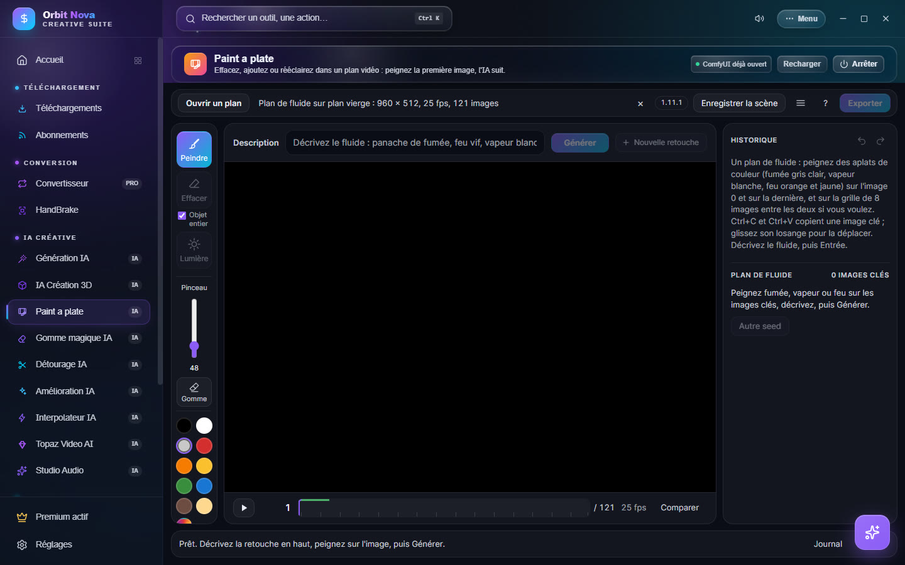
<b>Paint a plate</b> — retouche de plans vidéo par IA
</td>
  </tr>
  <tr>
    <td>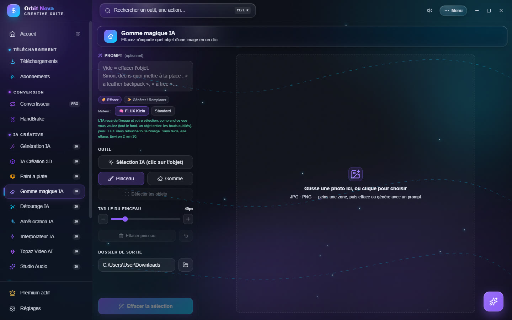
<b>Gomme magique IA</b> — effacer ou remplacer un objet
</td>
    <td>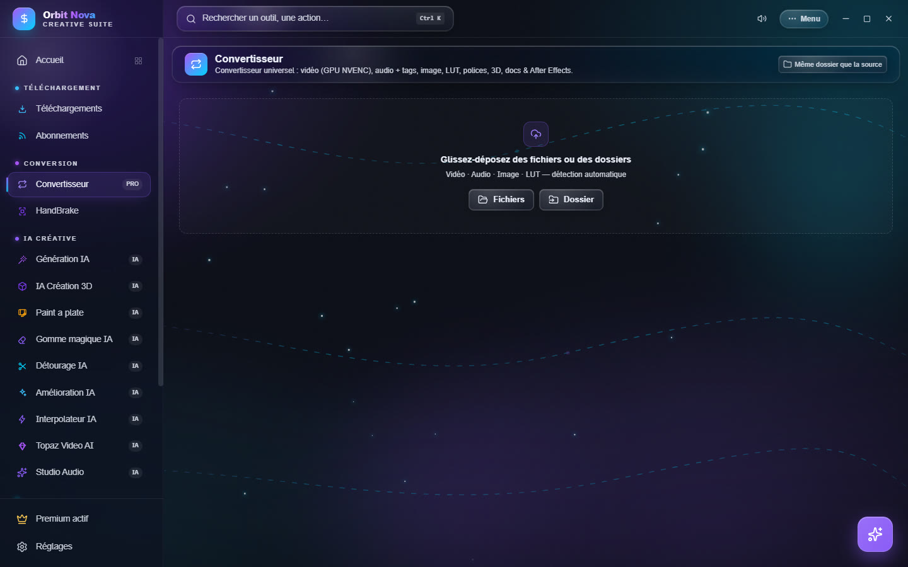
<b>Convertisseur</b> — vidéo, audio, image, 3D, polices, AE
</td>
  </tr>
  <tr>
    <td>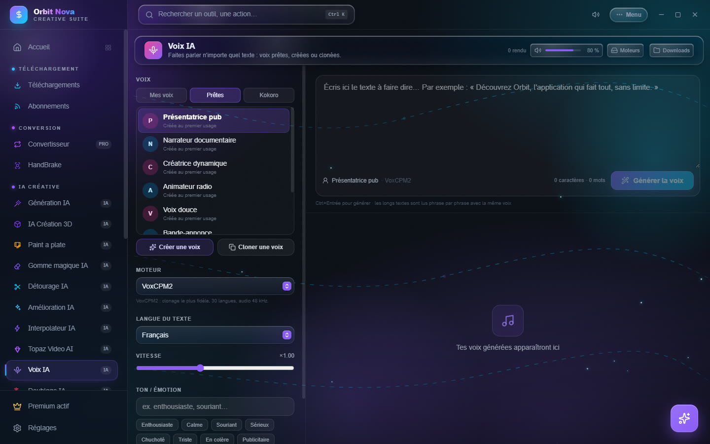
<b>Voix IA</b> — voix off, création et clonage de voix
</td>
    <td>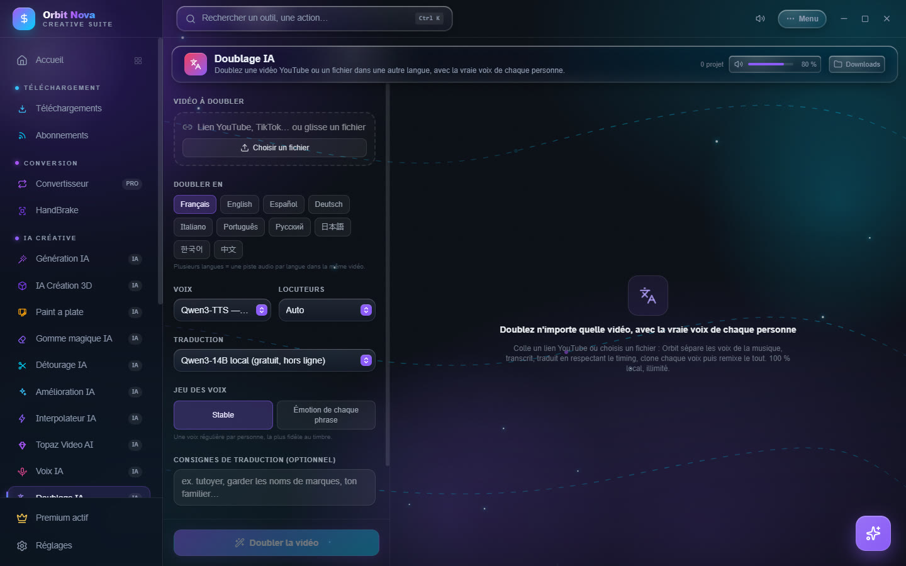
<b>Doublage IA</b> — une vidéo dans une autre langue, avec les vraies voix
</td>
  </tr>
  <tr>
    <td>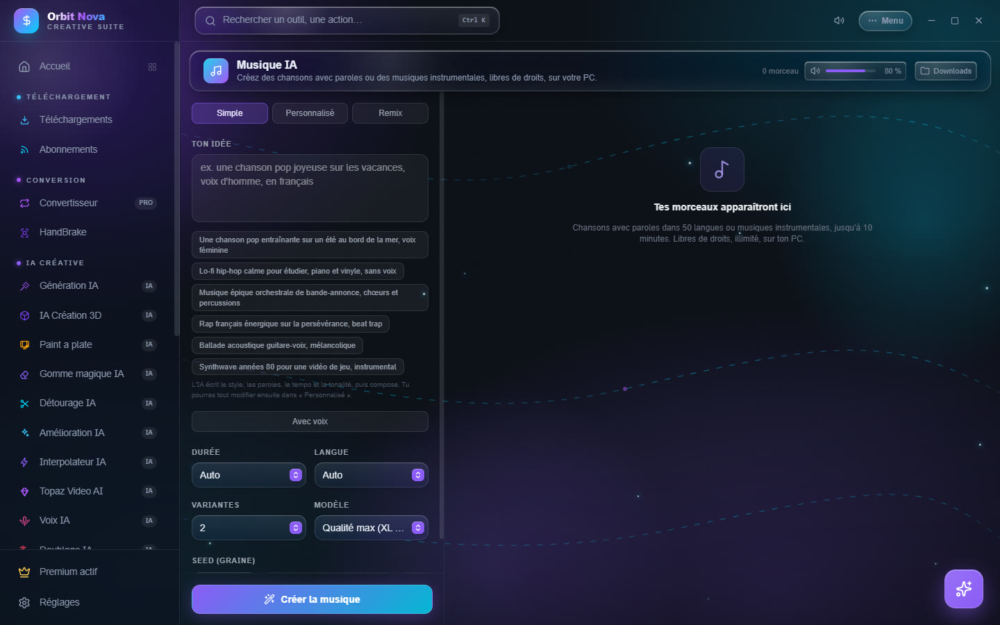
<b>Musique IA</b> — chansons complètes avec paroles, en local
</td>
    <td>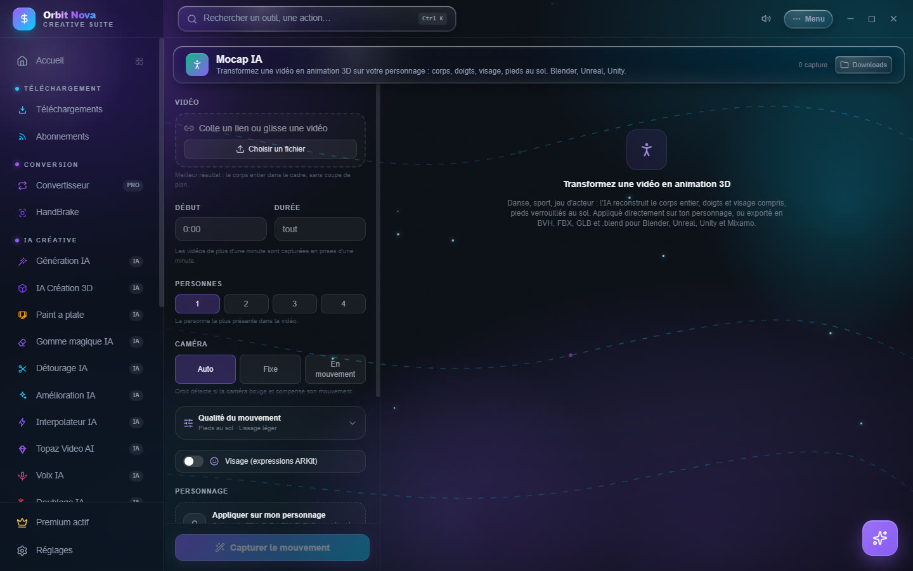
<b>Mocap IA</b> — une vidéo devient une animation 3D
</td>
  </tr>
</table>

## 💎 Gratuit ou Premium

Orbit est **gratuit**. **Orbit Premium** débloque les outils IA les plus avancés : **14,99 € une seule fois**,
à vie, pour un appareil.

| Gratuit | Premium |
|:--|:--|
| Téléchargements, Spotify / Apple Music / Deezer, abonnements | Génération IA, Gomme magique, Détourage, Amélioration |
| Convertisseur, HandBrake, boîte à outils, médiathèque | Interpolateur IA, Topaz Video AI, Transcription |
| IA Création 3D, Paint a plate | Voix IA, Doublage IA, Bruitages IA, Musique IA |
| Studio Audio (débruitage, normalisation, extraction) | Changeur de voix, Matériaux PBR, Mocap IA |
| Orbit Drive, assistant IA | Studio Audio : séparation en stems |

Détails dans la [documentation Premium](https://docs.orbit-drive.com/premium.html).

## 💻 Installation

1. Téléchargez **[Orbit-Installer.exe](https://github.com/ThomasDM40-dev/orbit-releases/releases/latest/download/Orbit-Installer.exe)**.
2. Lancez-le et suivez l'installation (aucun droit administrateur nécessaire).
3. C'est tout : Orbit **se met à jour tout seul**. Les moteurs (yt-dlp, FFmpeg…) et les modèles IA se
   téléchargent au premier usage de chaque outil.

> Windows peut afficher « Windows a protégé votre ordinateur » au premier lancement : cliquez
> **Informations complémentaires › Exécuter quand même**.

| | Minimum | Pour les outils IA |
|:--|:--|:--|
| **Système** | Windows 10 ou 11, 64 bits | Windows 10 ou 11, 64 bits |
| **Mémoire** | 8 Go | 16 Go ou plus |
| **Carte graphique** | Toute carte récente | NVIDIA RTX, 8 Go de VRAM ou plus (16 Go pour la 3D et Paint a plate) |
| **Disque** | 1 Go | De quelques Go à plus de 60 Go selon les modèles installés |

## 🔒 Vie privée

- Les outils IA tournent **sur votre PC** : vos images, vidéos et voix ne sont envoyées nulle part.
- Une fois les modèles téléchargés, ils marchent **sans connexion**.
- Orbit Drive chiffre vos fichiers **avant** l'envoi (AES-256) : ni le serveur ni Discord ne peuvent les lire.

## 📚 Liens

- 📖 **[Documentation complète](https://docs.orbit-drive.com/)** (français et anglais)
- 📝 **[Notes de version](https://github.com/ThomasDM40-dev/orbit-releases/releases)** — aussi dans l'app : *Menu › Outils › journal des modifications*
- 🐞 **Un bug ?** Dans Orbit : *Réglages › À propos › Signaler un bug*

 

   
  © 2026 Orbit · ThomasDM40-dev · Ce dépôt héberge les versions publiques d'Orbit (installeur et mises à jour) ; le code source n'est pas distribué.

